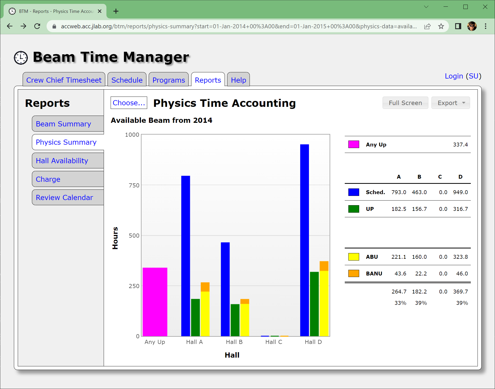

# btm [](https://github.com/JeffersonLab/btm/actions/workflows/ci.yaml) [](https://hub.docker.com/r/jeffersonlab/btm)
A [Jakarta EE 10](https://en.wikipedia.org/wiki/Jakarta_EE) web application for managing beam time at Jefferson Lab built with the [Smoothness](https://github.com/JeffersonLab/smoothness) web template.



---
- [Overview](https://github.com/JeffersonLab/btm#overview)
- [Quick Start with Compose](https://github.com/JeffersonLab/btm#quick-start-with-compose)
- [Install](https://github.com/JeffersonLab/btm#install)
- [Configure](https://github.com/JeffersonLab/btm#configure)
- [Build](https://github.com/JeffersonLab/btm#build)
- [Test](https://github.com/JeffersonLab/btm#test)
- [Develop](https://github.com/JeffersonLab/btm#develop) 
- [Release](https://github.com/JeffersonLab/btm#release)
- [Deploy](https://github.com/JeffersonLab/btm#deploy)
- [See Also](https://github.com/JeffersonLab/btm#see-also)  
---

## Overview
The Beam Time Manager application allows crew chiefs and experimenters to track machine time accounting while allowing management to review reports.  The app prompts crew chiefs and experimenters with shift timesheets pre-filled with data estimated via beam position sensor measurements.  The app also holds a database view of the NPES schedule, exposes programmatic access via a JSON REST service, and integrates with Program Deputy [shift plans](https://github.com/JeffersonLab/pd-shiftplans) and [DTM](https://github.com/JeffersonLab/dtm) to enable prompting timekeepers with the expected plan as well.  The timesheets therefore consist of Planned, Measured, and Reported values.

### State Timeline
The accelerator program (Physics, Studies, NPES Restore, ACC or Off) is kept as a timeline of intervals, shown on the State Timeline tab with the current program.  The app records a program change when the PV named by `BTM_PROGRAM_PV` changes, and Crew Chiefs can add, change and remove intervals to correct mistakes.  Each interval runs until the next one starts, so the timeline has no gaps or overlaps.

Downtime is not part of the timeline: it is recorded in [DTM](https://github.com/JeffersonLab/dtm) only.  The Measured accelerator program time of a Crew Chief timesheet is calculated from the timeline, and the time DTM has the machine down (blocked events) during Studies, NPES Restore or ACC is counted as Internal Down.  Hours that the timeline does not cover, such as those before it was first recorded, are as BOOM measured them.  Changing the timeline changes the Measured values of the timesheets it overlaps, but not the Reported values that were already saved.

## Quick Start with Compose
1. Grab project
```
git clone https://github.com/JeffersonLab/btm
cd btm
```
2. Launch [Compose](https://github.com/docker/compose)
```
docker compose up
```
3. Navigate to page
```
http://localhost:8080/btm
```

**Note**: Login with demo username "jdoe" and password "password".

### Ports
The containers publish these ports on the host, listening only on its local address (127.0.0.1), so other computers can't reach the demo database, accounts, and management consoles.  To use them from another computer, forward them over SSH, such as `ssh -N -L 8443:localhost:8443 -L 8081:localhost:8081 <host>` for the app and Keycloak.  If another project already uses some of them, or you run a second copy of the demo, set other ports in a `.env` file next to `compose.yaml`, which Compose reads, or in the environment:

| Variable                     | Default | Port of                        |
|------------------------------|---------|--------------------------------|
| BTM_HTTPS_PORT               | 8443    | app (HTTPS)                    |
| BTM_HTTP_PORT                | 8080    | app (HTTP)                     |
| BTM_MANAGEMENT_PORT          | 9990    | Wildfly management             |
| BTM_KEYCLOAK_PORT            | 8081    | Keycloak                       |
| BTM_KEYCLOAK_MANAGEMENT_PORT | 9991    | Keycloak management            |
| BTM_ORACLE_PORT              | 1521    | Oracle                         |
| BTM_ORACLE_EM_PORT           | 5500    | Oracle Enterprise Manager      |
| BTM_PUPPET_PORT              | 3000    | Puppet Show                    |
| BTM_SMTP_PORT                | 1025    | MailHog SMTP                   |
| BTM_MAILHOG_PORT             | 8025    | MailHog web UI                 |
| BTM_SOFTIOC_PORT             | 5064    | soft IOC Channel Access (TCP and UDP) |
| BTM_SOFTIOC_REPEATER_PORT    | 5065    | soft IOC CA repeater (TCP and UDP)    |

The app and Keycloak are set up for the ports you choose, so log in at `https://localhost:<BTM_HTTPS_PORT>/btm`.  The app reaches the soft IOC over the Compose network whatever its host ports are, but a Channel Access client on the host only works with the default soft IOC ports, since the IOC's search replies name port 5064.

Compose names the containers, network, and images after the project's directory, such as `btm-oracle-1`, so a copy in another directory, such as a git worktree, gets its own.

See: [Docker Compose Strategy](https://gist.github.com/slominskir/a7da801e8259f5974c978f9c3091d52c)

## Install
This application requires a Java 17+ JVM and standard library to run, plus a Jakarta EE 10 application server (developed with Wildfly).


1. Install service [dependencies](https://github.com/JeffersonLab/btm/blob/main/deps.yaml)
2. Download [Wildfly 37.0.1](https://www.wildfly.org/downloads/)
3. [Configure](https://github.com/JeffersonLab/btm#configure) Wildfly and start it
4. Download [btm.war](https://github.com/JeffersonLab/srm/releases) and deploy it to Wildfly
5. Navigate your web browser to [localhost:8080/btm](http://localhost:8080/btm)

## Configure

### Configtime
Wildfly must be pre-configured before the first deployment of the app. The [wildfly bash scripts](https://github.com/JeffersonLab/wildfly#configure) can be used to accomplish this. See the [Dockerfile](https://github.com/JeffersonLab/btm/blob/main/Dockerfile) for an example.

**Note**: In production users often leave multiple instances of the app open per counting house and concurrent hourly refreshes may result in concurrent DB request contention for the BTM connection pool.   Bumping up the [max allowed concurrent](https://github.com/JeffersonLab/wildfly/blob/92972bd45dc363c2ed4959bb725e0ba3ba052a6b/scripts/app-setup.sh#L99) DB connections can ameliorate this.  See Also: https://github.com/JeffersonLab/btm/issues/9#issuecomment-2819393849

### Runtime
Uses the [Smoothness Environment Variables](https://github.com/JeffersonLab/smoothness#environment-variables) plus the following application specific:

| Name                | Description                                                    |
|---------------------|----------------------------------------------------------------|
| LOGBOOK_DEBUG       | If set to "true" then TLOG is used as logbook                  |
| BTM_EPICS_ADDR_LIST | EPICS CA Address List for obtaining time keeping measurements. |
| BTM_PROGRAM_PV      | Optional name of the PV with the current accelerator program, which the State Timeline is recorded from.  If not set the timeline is only kept by hand. |

The value of the `BTM_PROGRAM_PV` PV must be a string or an enumeration whose label is `PHYSICS`, `STUDIES`, `RESTORE`, `ACC` or `OFF`, in any case; `NULL` is taken as `PHYSICS` and `MD` as `STUDIES`, as BOOM names them in its hourly PVs.  Any other value, such as `DOWN`, is ignored and logged: the current program stays what it was.  The demo's soft IOC has such a PV, `BOOMCEBAPROGRAM`, which you can change to see the timeline follow, for example with `docker compose exec softioc caput BOOMCEBAPROGRAM STUDIES`.

Host names in `BTM_EPICS_ADDR_LIST` are looked up when EPICS monitoring starts.  While any PV is not connected they are looked up again every 30 seconds, and monitoring restarts if one resolves to an address it did not have before, so an IOC host that DNS did not know at startup, or whose address changed, is picked up without a CA reset.

### Database
This application requires an Oracle 19+ database with the following [schema](https://github.com/JeffersonLab/btm/tree/main/container/oracle/initdb.d) installed.   The application server hosting this app must also be configured with a JNDI datasource.

## Build
This project is built with [Java 21](https://adoptium.net/) (compiled to Java 17 bytecode), and uses the [Gradle 9](https://gradle.org/) build tool to automatically download dependencies and build the project from source (the full build also requires Docker for the integration tests):

```
git clone https://github.com/JeffersonLab/btm
cd btm
gradlew build
```
**Note**: If you do not already have Gradle installed, it will be installed automatically by the wrapper script included in the source

**Note for JLab On-Site Users**: Jefferson Lab has an intercepting [proxy](https://gist.github.com/slominskir/92c25a033db93a90184a5994e71d0b78)

See: [Docker Development Quick Reference](https://gist.github.com/slominskir/a7da801e8259f5974c978f9c3091d52c#development-quick-reference)

## Test

Run the unit tests without external services:

```sh
./gradlew test
```

The EPICS monitor tests run a synthetic IOC, CAJ's Channel Access server, inside the test JVM,
on loopback with free ports and made-up PV names; they contact no other IOC.

Run the database integration tests with Java 21 and a running Docker daemon:

```sh
./gradlew integrationTest
```

On this project's rootless Docker setup, expose the socket to Testcontainers:

```sh
DOCKER_HOST=unix://$XDG_RUNTIME_DIR/docker.sock ./gradlew integrationTest
```

The suite under `src/integrationTest/java` starts a disposable Oracle XE 21.3.0 container
with Testcontainers, using the same image as the demo. The first run may take several minutes
to download and initialize Oracle. It creates `BTM_OWNER` and loads the project's
[Oracle DDL](container/oracle/initdb.d/02_ddl.sql), without Hibernate schema generation.
Only synthetic test data is inserted; each test rolls back its transaction. Containers use
random names and host ports, no shared volumes, and are removed automatically after the suite.
No existing Compose services or external databases are needed.

Coverage includes monthly version ordering, published and tentative schedule selection,
inclusive month ranges, schedule creation/publication, and Oracle's missing-day projection
(including nulls, numeric/boolean conversion and a DST transition). It also includes the State
Timeline's queries and changes, DTM downtime read as time spans, and the accelerator hours
calculated from both (including the repeated hour when daylight saving time ends). The tests
call services with a real Hibernate EntityManager; they do not exercise WildFly's EJB
security/JTA or HTTP.

`./gradlew build` and `./gradlew check` run both suites, including in CI, and therefore require
Docker. A missing Docker daemon fails the integration suite instead of skipping it.
Reports are written to `build/reports/tests/test/index.html` and
`build/reports/tests/integrationTest/index.html`. To package the WAR without running checks,
use `./gradlew assemble`. The Docker image build excludes both test tasks because it runs
inside the image builder without a Docker daemon.

## Develop
In order to iterate rapidly when making changes it's often useful to run the app directly on the local workstation, perhaps leveraging an IDE.  In this scenario run the service dependencies with:
```
docker compose -f deps.yaml up
```
**Note**: The local install of Wildfly should be [configured](https://github.com/JeffersonLab/btm#configure) to proxy connections to services via localhost and therefore the environment variables should contain:
```
KEYCLOAK_BACKEND_SERVER_URL=http://localhost:8081
FRONTEND_SERVER_URL=https://localhost:8443
BTM_EPICS_ADDR_LIST=localhost
```
Further, the local DataSource must also leverage localhost port forwarding so the `standalone.xml` connection-url field should be: `jdbc:oracle:thin:@//localhost:1521/xepdb1`.  These are the default [ports](#ports); use yours if you set others, except for the soft IOC, which a local Wildfly reaches only on the defaults.

The [server](https://github.com/JeffersonLab/wildfly/blob/main/scripts/server-setup.sh) and [app](https://github.com/JeffersonLab/wildfly/blob/main/scripts/app-setup.sh) setup scripts can be used to setup a local instance of Wildfly. 

## Release
1. Bump the version number in the VERSION file and commit and push to GitHub (using [Semantic Versioning](https://semver.org/)).
2. The [CD](https://github.com/JeffersonLab/btm/blob/main/.github/workflows/cd.yaml) GitHub Action should run automatically invoking:
    - The [Create release](https://github.com/JeffersonLab/java-workflows/blob/main/.github/workflows/gh-release.yaml) GitHub Action to tag the source and create release notes summarizing any pull requests.   Edit the release notes to add any missing details.  A war file artifact is attached to the release.
    - The [Publish docker image](https://github.com/JeffersonLab/container-workflows/blob/main/.github/workflows/docker-publish.yaml) GitHub Action to create a new demo Docker image.
    - The [Deploy to JLab](https://github.com/JeffersonLab/general-workflows/blob/main/.github/workflows/jlab-deploy-app.yaml) GitHub Action to deploy to the JLab test environment.

## Deploy
The deploy to JLab's acctest is handled automatically via the release workflow.

At JLab this app is found at [ace.jlab.org/btm](https://ace.jlab.org/btm) and internally at [acctest.acc.jlab.org/btm](https://acctest.acc.jlab.org/btm).  However, those servers are proxies for `wildfly3.acc.jlab.org` and `wildflytest3.acc.jlab.org` respectively.   A [deploy script](https://github.com/JeffersonLab/wildfly/blob/main/scripts/deploy.sh) is provided on each server to automate wget and deploy.  Example:

```
/root/setup/deploy.sh btm v1.2.3
```

**JLab Internal Docs**:  [RHEL9 Wildfly](https://acgdocs.acc.jlab.org/en/ace/builds/rhel9-wildfly)

## See Also
 - [JLab ACE management-app list](https://github.com/search?q=org%3Ajeffersonlab+topic%3Aace+topic%3Amanagement-app&type=repositories)
